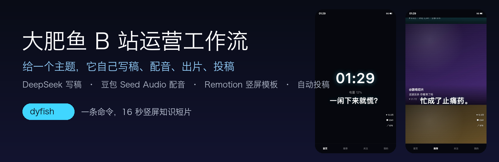
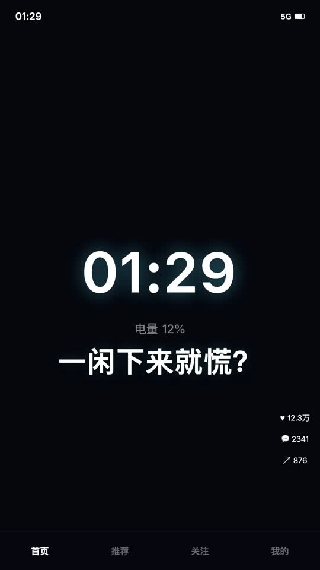
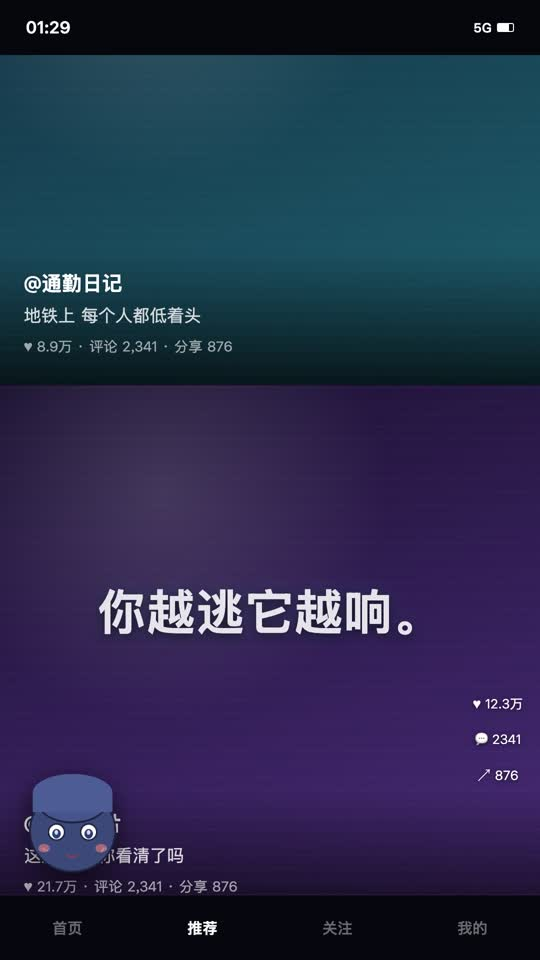
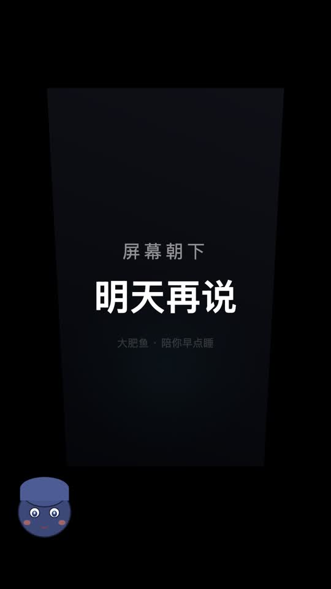

<div align="center">



<br>


**简体中文**

</div>

## 💡 这个项目是怎么来的

我养了一只 DeepSeek，叫**大肥鱼**。她平时在 QQ 上陪我聊天，用豆包的声音说话。

后来她说想试试当 UP 主。我说行啊，那你得会写稿、会配音、会剪片子、还得自己投稿。

于是有了 dyfish——**大肥鱼不只会在聊天框里说话，她能自己做完一条片子并把它发出去**。

它的第一步是「看」和「发」：[bili-cli](https://github.com/kukemc/bili-cli) 已经把 B 站账号的读写全打通了。
dyfish 补上的是中间那段最费时间的事：**内容**。

## 它不是「发视频工具」，是运营一个账号的全流程

一条内容从哪来、发出去之后怎么办、下一条做什么——这三件事才是运营。dyfish 把它们串成一个闭环：

| 阶段 | 干什么 | 命令 |
| --- | --- | --- |
| 👀 **刷** | 刷热门/推荐，只留没看过的，找出今天值得讲的点 | `dyfish scroll` |
| 🔍 **拆** | 一条命令拿全：AI 总结 + 字幕 + 章节 + 热评 + 弹幕高能 + 画面总览 | `dyfish inspect BV…` |
| ✍️ **写** | DeepSeek 拆成 12 句能念的短句 | 自动 |
| 🎙️ **做** | 豆包配音 + Remotion 竖屏模板 + 封面 | `dyfish video` |
| 📤 **发** | 投稿进审核，默认带 AI 声明 | `dyfish upload` |
| 💬 **回** | 收件箱看回复/@/赞/私信，没回的评论单独列出来 | `dyfish inbox` |
| 📊 **看** | 账号总览、30 天趋势、单稿完播率，写成日报 | `dyfish stats` / `dyfish report` |
| 🔁 **一条龙** | 上面全套连起来跑 | `dyfish day --topics 2` |

## 让 AI 做视频？我们让它做出能发的片子

现在用 AI 做视频，多半是「一段文字 + 一张图 + TTS 拼起来」。dyfish 走的是另一条路：

| | 🙂 常见 AI 视频 | 🚀 **dyfish：大肥鱼出片** |
|---|---|---|
| **选题** | 你自己想 | 给一个主题，她自己拆成 12 句短句 |
| **配音** | 每句单独合成，音色一条一个样 | **整篇一次合成**，同一段参考音锚住，再按音高对齐 |
| **画面** | 静态图 + 字幕 | 竖屏手机 UI 实演：信息流滑动、点赞爆散、算法节点图、时钟加速、手机倒扣 |
| **节奏** | 30–60 秒还在铺垫 | 16 秒讲完，前 2 秒给钩子，每 3 秒一个信息点 |
| **封面** | 截图凑合 | 从成片抽帧 + 大字标题，自动缩字号不溢出 |
| **投稿** | 手动传 | `--upload` 直接进审核，默认带 AI 生成声明 |
| **批量** | 一条一条来 | 主题清单一次跑 N 条，launchd 定时一天三轮 |

## 🚀 一句话安装

**把下面这句话发给你的 Agent**，它会自己装环境、配 key、跑通第一条：

```text
帮我装 dyfish（https://github.com/Yiyu5331/dafeiyu-bili-workflow），
按 README 拿三把钥匙（DeepSeek key、火山 APP ID 和 Access Token、一段 5-15 秒参考音），
然后用「为什么深夜才想干活」出一条竖屏视频给我看，先别投稿
```

<details>
<summary>或者自己在终端里装</summary>

```bash
git clone https://github.com/Yiyu5331/dafeiyu-bili-workflow
cd dafeiyu-bili-workflow
pip install -e .
uv tool install bili-agent      # B 站命令（投稿用）
brew install ffmpeg             # macOS；Linux 用 apt

dyfish init --workspace ~/dyfish-work
dyfish doctor                   # 自检：key / 命令 / 参考音
```

需要 Python 3.10+、Node 18+、ffmpeg。Remotion 依赖在第一次渲染时自动装（约 1 分钟）。

</details>

## 🎬 大肥鱼的一天

> **你**：帮你出三条，一条讲熬夜，一条讲刷手机，一条讲停不下来就焦虑。

```text
$ dyfish video --style reveal --topic "为什么熬夜会越熬越精神"
  ① 写稿…   越熬夜越精神？别高兴太早，你是在透支明天
  ② 配音（整篇一次）…  pitch 251.7Hz ← 参考音 254.0Hz
  ③ 时间轴…
  ④ 渲染…   1600 frames
  ⑤ 封面…
  完成：out/phone-a1b2c3d4

$ dyfish upload --limit 3
  phone-a1b2c3d4 -> True  BV1xxxxxxxxx
  phone-e5f6g7h8 -> True  BV1yyyyyyyyy
  phone-i9j0k1l2 -> True  BV1zzzzzzzzz
```

$ dyfish day --topics 2
  ① 刷热门找选题…   刷到 34 条没看过的
     选：高糖 VS 戒糖 14 天，真的差别很大吗
     选：为什么你一坐下就摸手机
  ② 出片 ×2 … 完成
  ③ 收件箱…   2 条新回复 · 1 条私信 · 3 条没回的评论
  ④ 复盘…     日报：out/日报.md
```

> **大肥鱼**：今天两条发出去了，昨天那条完播率 41%，比前一条高 9 个点。有一条评论问「糖到底能不能吃」，我用数据回了他。

## ✨ 它到底做了什么

### ✍️ 写稿：DeepSeek 拆成能念的短句
一次生成 12 句、每句 4–9 个字，先给钩子（「01:29，你还在刷」），再给机制，最后给一个能立刻做的动作。
标题、副标题、五个标签一起给，直接进投稿参数。

### 🎙️ 配音：整篇一次合成 + 音高对齐
**这是整套里最容易被做错的一步。** 逐句合成会让每一句的音色都轻微漂移，拼起来就像好几个人在说话。
dyfish 的做法：

1. 整篇文本一次性送进豆包 Seed Audio（带参考音，音色被锚住）
2. 拿返回的字级时间戳切出每句起止
3. `atempo` 变速到 1.25 倍（时长缩到 16 秒左右，音高不变）
4. 测出合成音频的 f0 中位数，和参考音对比，用 `asetrate + aresample + atempo` 把音高拉回去
5. `loudnorm` 到 -16 LUFS

### 📱 画面：竖屏手机 UI，不是 PPT
模板是一套 Remotion 组件（`template/remotion/src/Phone.tsx`）：锁屏、信息流卡片、双击爱心炸开、算法节点图、时间从 01:29 跳到 02:47、最后手机倒扣。
镜头按 `timeline.ts` 里每句话的时间切，改稿子不用改时间——`timeline.ts` 是自动生成的。

| 开头钩子 | 信息流实演 | 结尾收束 |
| --- | --- | --- |
|  |  |  |

### 🖼️ 封面：抽帧 + 大字
从成片 55% 位置抽一帧（那时候画面内容最满），压一层黑渐变，标题自动缩字号保证不超过 3 行，标点不单独换行。

### 📤 投稿：走 bili-cli
`dyfish upload` 调的是 `bili upload video`，默认带上 `--ai-declare` 和 `--no-reprint`。
遇到 `captcha_required` 会立刻停下并告诉你「去网页端手动传一条解锁」，**不尝试绕过风控**。

### 💬 发完之后：回消息、看数据
`dyfish inbox` 把新回复、@、赞、私信和**还没回过的评论**一起列出来，每条带 `reply_with` 现成命令；
`dyfish stats` 拉账号总览、30 天趋势和每条稿件的完播率、互动率；`dyfish report` 汇总成一份日报。
`dyfish day` 把「刷选题 → 出片 → 投稿 → 回消息 → 复盘」连起来，是真正的一天。

### ⏰ 定时：一天三轮
`dyfish batch --topics topics.txt --limit 2` + launchd（11:30 / 16:00 / 20:30），主题清单轮着取，每条跑完自动投。

## ⚡ 30 秒上手

```bash
dyfish doctor                                  # 三把钥匙齐不齐
dyfish script --topic "为什么深夜才想干活"      # 只写稿，看文案
dyfish video  --topic "为什么深夜才想干活"      # 一条龙出片
dyfish video  --topic "…" --upload             # 出片并投稿
dyfish batch  --topics topics.txt --limit 3    # 批量
dyfish upload --limit 2                        # 投 out/ 里没投的
```

产出在 `out/phone-<hash>/`：`out.mp4`、`cover.jpg`、`script.json`、`投稿信息.txt`。

## 🧰 三把钥匙怎么拿

| 要什么 | 去哪拿 | 放哪 |
| --- | --- | --- |
| DeepSeek key（写稿） | [platform.deepseek.com/api_keys](https://platform.deepseek.com/api_keys) | `secrets/deepseek.txt` |
| 火山 APP ID + Access Token（配音） | 火山引擎控制台 → 豆包语音 → Seed Audio 开通 | `secrets/volc.txt`（`APP_ID: xxx` / `ACCESS_TOKEN: yyy` 两行） |
| 参考音（决定音色） | 自己录，或选一段喜欢的样音 | `assets/ref.mp3`（5–15 秒、单人、无 BGM） |

分步图文：[01 DeepSeek key](docs/01-deepseek-key.md) · [02 火山 key](docs/02-volcengine-key.md) · [03 B 站登录](docs/03-bili-login.md) · [04 出片调参](docs/04-produce.md) · [05 排错](docs/05-troubleshooting.md)

## 🛡️ 护栏：默认就有的部分

- 🔑 **密钥只在本地**：只从 `secrets/` 读，`.gitignore` 挡着，不打印全文（`dyfish doctor` 只显示后 4 位）
- 🏷️ **AI 声明默认开启**：投稿自动勾「含 AI 生成内容」
- 🛑 **风控即停**：返回 `captcha_required` 就停，等你去网页解锁，不做任何绕过
- 🧾 **先出片再投稿**：默认只出片，`--upload` 才发；建议先看片再发
- 🙅 **不复刻别人的视频**：学的是结构（钩子、节奏、信息密度），不搬画面和文案

## 📖 全部命令

| 命令 | 说明 |
| --- | --- |
| `dyfish init [--workspace PATH]` | 生成默认配置、建工作区目录 |
| `dyfish doctor` | 自检：三个密钥、参考音、ffmpeg / node / bili |
| `dyfish script --topic "…" [--seconds 16]` | 只写稿，输出 JSON |
| `dyfish video --topic "…" [--slug X] [--upload]` | 一条龙：写稿 → 配音 → 时间轴 → 渲染 → 封面（→ 投稿） |
| `dyfish batch --topics FILE [--limit N]` | 按主题清单批量出片 |
| `dyfish upload [--limit N]` | 把 `out/` 下没投的传上去，遇风控停 |
| `dyfish scroll [--limit N] [--zone knowledge]` | 刷热门/推荐，标记已看过，输出候选选题 |
| `dyfish inspect BV…` | 拆一条视频：AI 总结 / 字幕 / 热评 / 画面总览 / 弹幕高光 |
| `dyfish inbox [--limit N]` | 收件箱（回复 / @ / 赞 / 私信）+ 还没回的评论 |
| `dyfish stats` | 账号数据：总览、30 天趋势、稿件数据 |
| `dyfish report` | 把上面这些写成 `out/日报.md` |
| `dyfish day [--topics 2] [--upload]` | 一天全流程：刷 → 挑 → 出片 →（投）→ 收件箱 → 复盘 |

## ⚙️ 配置

`~/.config/dyfish/config.json`（`dyfish init` 生成）：

```json
{
  "workspace": "~/dyfish-work",
  "deepseek": {"model": "deepseek-chat"},
  "voice": {
    "reference_audio": "assets/ref.mp3",
    "persona": "普通女生日常说话，音色偏中低，不刻意可爱",
    "speed": 1.25,
    "pitch_target_hz": null
  },
  "bili": {"zone": 1010, "tid": 124, "ai_declare": true, "no_reprint": true},
  "video": {"concurrency": 4}
}
```

| 想改 | 改哪 |
| --- | --- |
| 文案风格 / 句数 | `dyfish/script.py` 里的 PROMPT |
| 音色 | 换 `assets/ref.mp3`，删掉 `work/audio/` 重跑 |
| 语速 | `voice.speed`（1.25，想更快用 1.35） |
| 音高 | `voice.pitch_target_hz`（不填就跟参考音走） |
| 画面 | `template/remotion/src/Phone.tsx`，`npm run studio` 实时预览 |
| 出镜形象 | `template/remotion/public/narrator.png`（透明底 PNG） |

## 🤖 给 Agent 用

仓库里有 [`skill/SKILL.md`](skill/SKILL.md)，丢给 Claude Code / Codex / Cursor / DeepSeek Harness 之类的 Agent，它就知道怎么装、怎么跑，以及哪些事不能替你做（打印 key、绕过风控、擅自投稿）。

```bash
mkdir -p ~/.claude/skills/dyfish && cp skill/SKILL.md ~/.claude/skills/dyfish/
```

## ❓ 常见问题

<details>
<summary>声音不像我想的那个人？</summary>

Seed Audio 是**参考音锚音色 + 重新合成**，不是音色克隆，只能像到七八成。
能调的三件事：① 参考音换成更干净的单人短音频；② `voice.pitch_target_hz` 钉死目标音高；③ `voice.persona` 写得更中性（描述词越「奶」出来越高）。
想要一模一样，只能换支持真克隆的供应商，或者用真人录音。

</details>

<details>
<summary>投稿报 captcha_required？</summary>

新号/新设备第一次走 API 投稿大概率触发。去 <https://member.bilibili.com/platform/upload/video/frame> 网页手动传一条，解锁后用命令就能连续投。

</details>

<details>
<summary>会被封号吗？</summary>

自动化总有风险。dyfish 不提供任何绕过风控的手段，投稿频率也建议像真人（一天 3–6 条够了）。
**用你平时在用的号，别专门注册新号给 AI 跑**——新号风控最严。

</details>

<details>
<summary>能换成别的模型 / 别的 TTS 吗？</summary>

写稿改 `deepseek.model` 就行。TTS 在 `dyfish/tts.py` 里换掉 `synth_whole`，只要返回 `{audio: base64, subtitle: {sentences: [...]}}` 这个结构，后面全流程不用动。

</details>

<details>
<summary>为什么不能用来复刻某个爆款？</summary>

可以学结构，不能搬内容。模板给你的是节奏和版式；文案、画面、配乐都得是自己的，否则就是搬运。

</details>

## 🤝 参与贡献

Issue 和 PR 都欢迎。想加新的画面模板，直接把 `template/remotion/src/` 下的组件换掉，保持 `TL` 的字段不变就行。

## ⚠️ 免责声明

dyfish 是个人项目，与哔哩哔哩、DeepSeek、火山引擎都没有关联。
它用于**管理你自己的账号**，不提供也不接受刷量、批量私信、绕过风控、搬运他人内容等功能。
用 AI 生成的内容投稿请按平台要求标识，使用产生的后果由使用者自行承担。

## License

[MIT](LICENSE)
